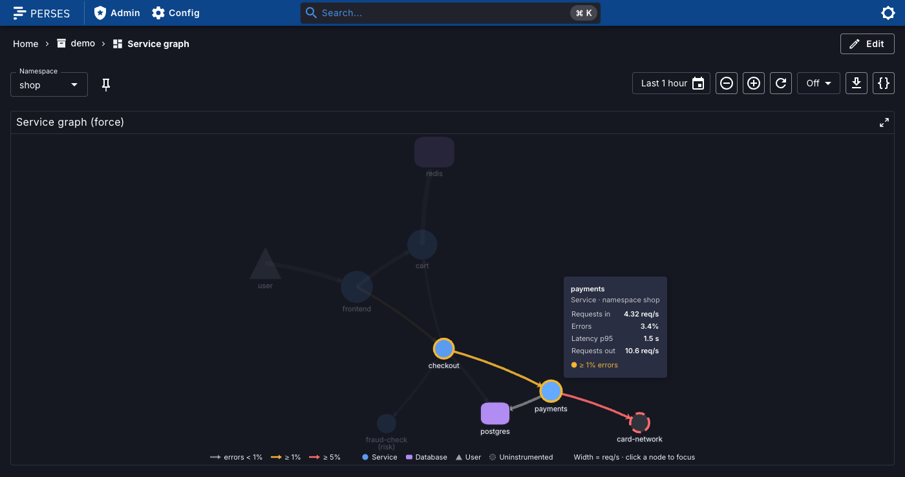
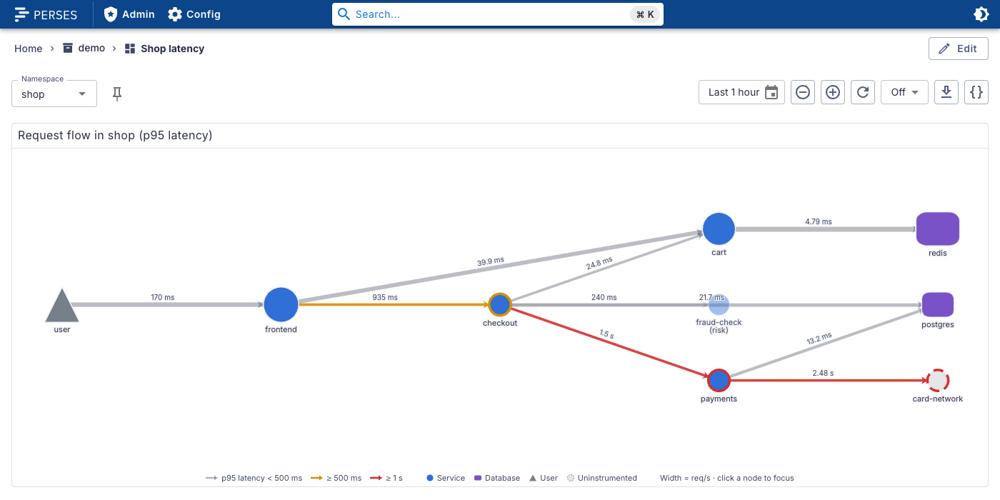
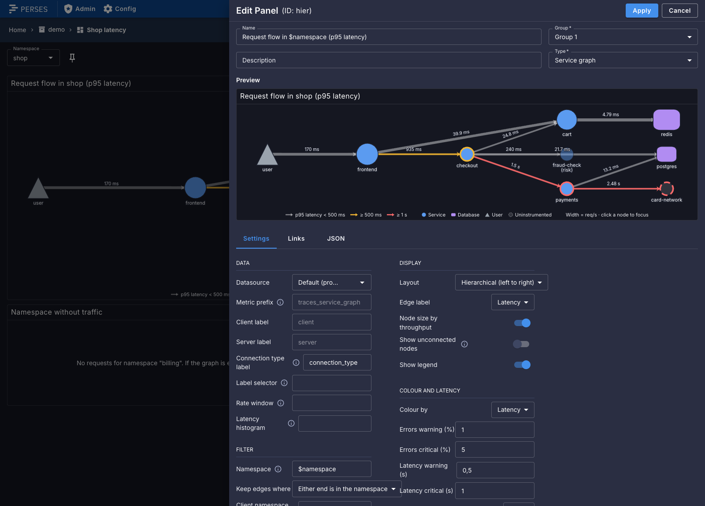

# perses-plugin-servicegraph

A [Perses](https://perses.dev) panel plugin, `ServiceGraphChart`, that draws a service graph from
the service-graph metrics produced by the
[Tempo metrics-generator](https://grafana.com/docs/tempo/latest/metrics-generator/service_graphs/) or
the OpenTelemetry Collector
[`servicegraph` connector](https://github.com/open-telemetry/opentelemetry-collector-contrib/tree/main/connector/servicegraphconnector).
Nodes are services and edges are requests between them. Both show request rate, error ratio and
latency, and the graph can be limited to one Kubernetes namespace.



| Light theme, hierarchical layout, p95 latency | Panel editor |
| --- | --- |
|  |  |

The screenshots use synthetic data for a demo namespace, `shop`.

## Supported versions

| Plugin | Perses | Status |
| --- | --- | --- |
| 0.1.x | v0.54.x | Tested with v0.54.0 |

The plugin is built against `@perses-dev/*` 0.54 and `percli` v0.54.0. Other Perses minor versions may
work but are not tested; see [Why ECharts](#why-echarts) for the part most likely to break.

## What it does

- **Nodes** are services. Their size follows throughput (optional), their ring colour follows the
  error ratio or latency of what they served, and their shape shows the kind of node (below).
- **Edges** point from caller to callee. Width follows request rate, colour follows error ratio or
  latency, and an optional label shows rate, error ratio or latency.
- **Tooltips:** on a node, requests in and out, error ratio, latency, kind and namespace; on an edge,
  request rate, error ratio with the failed rate, and latency.
- **Hover** a node to highlight its neighbours. **Click** a node to keep that focus; click it again or
  the empty canvas to clear it.
- **Namespace filter.** With a namespace set (usually `$namespace`), the panel keeps edges where
  either end, both ends, only the caller or only the callee is in the namespace. Nodes outside it are
  dimmed and named `service (namespace)`.
- **Layouts:** force-directed, or hierarchical from left (entry points) to right (leaves).
  Disconnected parts of the graph are laid out separately and stacked, largest first. Both layouts are
  deterministic, so the graph does not jump between refreshes.
- **Legend** for the colour thresholds and the node kinds present, in light and dark themes.
- **No data:** when the queries return nothing, the panel says so. With a namespace filter it names
  the namespace and points at the missing dimension (below) as the likely cause.

### Node kinds

The generators create a node for each end of a call, even when only one end was traced. The kind is
derived from the `connection_type` label and from which side reported the call:

| Kind | Shape | When |
| --- | --- | --- |
| Service | circle | An instrumented service: it called something, or it served a call that has no connection type |
| Database | rounded square | The callee of a `connection_type="database"` call |
| Messaging | diamond | The callee of a `connection_type="messaging_system"` call |
| User | triangle | The virtual caller `user`: requests that reached a service without a client span |
| Uninstrumented | dashed circle | The callee of a `connection_type="virtual_node"` call, for example an external API |

A node that shows up as an instrumented service anywhere in the graph is always drawn as a service.

### Queries

The panel runs its own PromQL through the selected Prometheus datasource: four instant queries at the
end of the dashboard's time range. With the defaults, namespace `shop` and the `either` match, a
one-hour range gives:

```promql
# request rate per edge
sum by (client, server, connection_type, client_k8s_namespace_name, server_k8s_namespace_name) (
  (rate(traces_service_graph_request_total{client_k8s_namespace_name=~"shop"}[3600s])
   or rate(traces_service_graph_request_total{server_k8s_namespace_name=~"shop"}[3600s])))

# failed requests per edge: the same with traces_service_graph_request_failed_total

# p95 latency per edge
histogram_quantile(0.95, sum by (client, server, connection_type, ..., le) (
  (rate(traces_service_graph_request_server_seconds_bucket{client_k8s_namespace_name=~"shop"}[3600s]) or ...)))

# p95 latency per node (everything it served)
histogram_quantile(0.95, sum by (server, le) (
  (rate(traces_service_graph_request_server_seconds_bucket{client_k8s_namespace_name=~"shop"}[3600s]) or ...)))
```

The window is the whole dashboard range unless the spec sets `window`. The namespace labels are only
added to `by` when a namespace filter is set, so the panel also works on metrics without them.

## Namespace dimension

By default neither Tempo nor the OpenTelemetry connector puts a namespace on the service-graph
metrics: the series have `client`, `server` and `connection_type` only. To filter by namespace, add the
Kubernetes namespace as a dimension, so each series gets `client_k8s_namespace_name` and
`server_k8s_namespace_name`. The namespace must be a resource attribute on your spans (the
OpenTelemetry Operator, the `k8sattributes` processor or `OTEL_RESOURCE_ATTRIBUTES` can set it).

**Tempo** (metrics-generator config or per-tenant overrides):

```yaml
metrics_generator:
  processor:
    service_graphs:
      dimensions:
        - k8s.namespace.name
      enable_client_server_prefix: true   # client_ and server_ prefixes on dimensions
```

**OpenTelemetry Collector:**

```yaml
connectors:
  servicegraph:
    dimensions:
      - k8s.namespace.name
```

Check the label names your version produces and set `clientNamespaceLabel` and
`serverNamespaceLabel` if they differ. A service normally runs in one namespace, so the dimension adds
few or no series per edge.

Without the dimension, leave `namespace` empty and use `serviceFilter` (a regex on service names) or
`labelSelector` (for example `cluster="prod"`) to narrow the graph.

## Spec

```yaml
plugin:
  kind: ServiceGraphChart
  spec:
    datasource: { kind: PrometheusDatasource, name: prometheus }  # default datasource when omitted
    metricPrefix: traces_service_graph
    clientLabel: client
    serverLabel: server
    connectionTypeLabel: connection_type   # "" turns node kinds off
    labelSelector: 'cluster="prod"'        # extra matchers on every query
    window: 5m                             # default: the dashboard's time range
    latencyMetric: ""                      # default: <prefix>_request_<latencySource>_seconds
    namespace: $namespace                  # value or regex; "" means no filter
    namespaceMatch: either                 # either | both | client | server
    clientNamespaceLabel: client_k8s_namespace_name
    serverNamespaceLabel: server_k8s_namespace_name
    serviceFilter: "checkout|payments"     # regex; keeps edges where either end matches
    latencyPercentile: p95                 # p50 | p90 | p95 | p99
    latencySource: server                  # server (callee) | client (caller, network included)
    edgeColorBy: errors                    # errors | latency
    errorThresholds: { warning: 1, critical: 5 }       # percent
    latencyThresholds: { warning: 0.5, critical: 1 }   # seconds
    layout: force                          # force | hierarchical
    edgeLabel: none                        # none | rate | errors | latency
    nodeSizeByThroughput: true
    showUnconnected: false                 # keep nodes whose edges had no requests
    showLegend: true
```

Every field is optional. The CUE schema is in `schemas/panels/service-graph-chart/`, with a complete
example next to it. A panel in a dashboard, with a namespace variable:

```yaml
variables:
  - kind: ListVariable
    spec:
      name: namespace
      plugin:
        kind: PrometheusLabelValuesVariable
        spec:
          labelName: client_k8s_namespace_name
          matchers: [traces_service_graph_request_total]
panels:
  serviceGraph:
    kind: Panel
    spec:
      display: { name: Service graph }
      plugin:
        kind: ServiceGraphChart
        spec:
          namespace: $namespace
          layout: hierarchical
          edgeLabel: rate
```

The panel has no query editor: it builds its queries from the spec, which the Settings tab edits.

## Why ECharts

Perses already ships ECharts 5.5 and shares one copy with every plugin through module federation. Its
graph series covers nodes, edges, symbols, labels, emphasis and tooltips, so the plugin adds no
charting library and has no runtime dependencies of its own.

The graph is drawn with `init` from the shared `echarts` module (see `GraphCanvas.tsx`), not with
Perses' `EChart` component. That component uses Perses' trimmed `echarts/core` build, which has no
graph series. The plugin therefore depends on Perses continuing to share the full `echarts` package.
Re-test it on every Perses upgrade.

Layouts are computed by the plugin (`layout.ts`) and handed to ECharts as fixed positions. That keeps
them stable between refreshes and lets the panel keep the graph's aspect ratio.

## Build

You need Node 22 or later, [`percli`](https://github.com/perses/perses/releases/tag/v0.54.0) v0.54.0
and [`cue`](https://cuelang.org) on `PATH` (v0.17.1 tested). `percli` uses `cue` to vendor the Perses
CUE dependencies into the archive.

```bash
npm ci
npm run lint && npm run type-check
npm run build                 # module-federation bundle in dist/
percli plugin build           # validates the schema, writes ServiceGraph-0.1.0.tar.gz
```

`npm run dev` serves the plugin for `percli plugin start` against a running Perses. See
[CONTRIBUTING.md](CONTRIBUTING.md) for more.

## Install into Perses

Perses extracts every `*.tar.gz` in `plugin.archive_paths` into `plugin.path` at startup. Setting
`archive_paths` replaces the default, so keep the directory of bundled plugins in the list. Pick one
of the three options below and restart Perses.

### Option A: release archive

Download `ServiceGraph-<version>.tar.gz` from the
[GitHub releases](https://github.com/astrona-io/perses-plugin-servicegraph/releases), put it in a
directory Perses can read, and add that directory to the config:

```bash
curl -fLO https://github.com/astrona-io/perses-plugin-servicegraph/releases/download/v0.1.0/ServiceGraph-0.1.0.tar.gz
```

```yaml
plugin:
  archive_paths:
    - /etc/perses/plugins-archive        # plugins bundled with Perses
    - /etc/perses/plugins-archive-extra  # put ServiceGraph-0.1.0.tar.gz here
```

### Option B: Kubernetes image volume

The `Containerfile` packages the archive as a plugin-only OCI image (`FROM scratch`, the archive at the
image root). Build and push it to your registry:

```bash
percli plugin build
podman build -t ghcr.io/<owner>/perses-plugin-servicegraph:<version> .
podman push ghcr.io/<owner>/perses-plugin-servicegraph:<version>
```

Then mount it into the Perses pod as an
[image volume](https://kubernetes.io/docs/concepts/storage/volumes/#image) and add the mount path to
`archive_paths` as in option A. Image volumes need a cluster and container runtime that support them
(the `ImageVolume` feature; check your Kubernetes version and feature gates).

```yaml
volumes:
  - name: servicegraph-plugin
    image:
      reference: ghcr.io/<owner>/perses-plugin-servicegraph:<version>
      pullPolicy: IfNotPresent
containers:
  - name: perses
    volumeMounts:
      - name: servicegraph-plugin
        mountPath: /etc/perses/plugins-archive-extra
        readOnly: true
```

If the registry is private, add an `imagePullSecrets` entry to the pod as for any other image.

### Option C: custom Perses image

Copy the archive into the directory of bundled plugins. No config change is needed, because that
directory is in the default `archive_paths`:

```dockerfile
FROM persesdev/perses:v0.54.0
COPY ServiceGraph-0.1.0.tar.gz /etc/perses/plugins-archive/
```

## Known limitations

- Values come from instant queries over the window, so the graph shows an average over the dashboard
  range, not a time series. Set `window` for a shorter, more current view.
- Latency percentiles are interpolated from histogram buckets and are only as precise as the
  generator's buckets.
- Calls from a service to itself count towards its totals but are not drawn.
- In the hierarchical layout a long edge can pass behind a node in a middle column.

## Licences and credits

The plugin is Apache-2.0 (`LICENSE`). Third-party material and its notices are listed in `NOTICE`.
